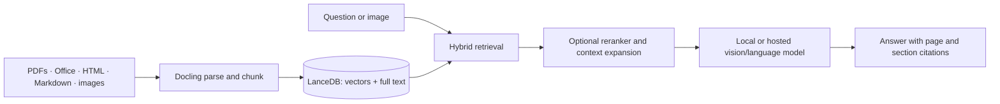

# Hybrid Search Engine

Local-first, self-hosted retrieval-augmented generation (RAG) for asking questions about your documents. It combines vector and full-text retrieval, optional reranking, multimodal document processing, and answers grounded with page and section citations.

The project runs with an embedded LanceDB by default and uses Ollama for local models out of the box. It also supports hosted model providers and LanceDB Cloud, S3, GCS, and Azure storage configurations.

> **Attribution:** This repository contains the MIT-licensed [haiku.rag](https://github.com/ggozad/haiku.rag) project by Yiorgis Gozadinos, copied with permission. The core implementation, reference app, and documentation originate from that project. The local changes here adapt the repository presentation and documentation-site metadata for this destination. See [LICENSE](LICENSE).

## How it works



Document ingestion preserves structure and page provenance. At query time, hybrid search retrieves relevant chunks, optional reranking refines the results, and the RAG capability composes an answer with citations. Image queries and figures in documents can use multimodal embedders or vision models.

## Capabilities

- **Document ingestion:** PDFs, office documents, HTML, Markdown, and images through Docling, in-process or via `docling-serve`.
- **Hybrid retrieval:** vector and full-text search, Reciprocal Rank Fusion, filters, multiple named databases, and section-aware context expansion.
- **Reranking:** optional cross-encoder, Jina, Cohere, Zero Entropy, vLLM, and OpenRouter integrations.
- **Grounded answers:** citations include page numbers and section headings; figure content can be sent to vision-capable models.
- **Local-first storage and models:** embedded LanceDB and Ollama work without a separate database server or hosted model key.
- **Interfaces:** CLI, Python API, Pydantic AI capabilities, MCP server, terminal chat, and a reference browser app.
- **Continuous ingestion:** a separate ingester service supports filesystem, HTTP, S3, and WebDAV sources, retryable jobs, and a control plane.
- **Operations:** tags and rollback, health checks, corpus inspection, duplicate analysis, and database maintenance tools.

## Install and try it

Python 3.12 or newer is required.

```bash
pip install haiku.rag
```

For the slim core with selected extras:

```bash
pip install haiku.rag-slim
```

The default model configuration uses Ollama. Install and start Ollama, then follow the [quickstart](https://ggozad.github.io/haiku.rag/tutorial/) to choose and pull models.

```bash
haiku-rag init
haiku-rag add-src paper.pdf
haiku-rag search "attention mechanism"
haiku-rag ask "What datasets were used for evaluation?"
haiku-rag chat
```

Ask a question about a local image with `haiku-rag ask "Does this figure match the spec?" --image figure.png`.

### Python API

```python
from haiku.rag.client import HaikuRAG

async with HaikuRAG("knowledge.lancedb", create=True) as rag:
    await rag.create_document_from_source("paper.pdf")
    results = await rag.search("self-attention")

    answer, citations = await rag.ask("What is the complexity of self-attention?")
    print(answer)
    for citation in citations:
        print(f"p.{citation.page_numbers}: {citation.content[:100]}")
```

See the [Python API guide](https://ggozad.github.io/haiku.rag/python/) and [capabilities guide](https://ggozad.github.io/haiku.rag/capabilities/) for customization.

## Browser app and self-hosting

The reference app provides chat, ingestion, document/chunk inspection, and corpus diagnostics. The documented deployment uses Docker Compose:

```bash
cd app
cp .env.example .env
cp config/haiku.rag.yaml.example config/haiku.rag.yaml
docker compose up -d
```

The app runs at `http://localhost:3000`. It uses a backend, frontend, ingester, and Docling processing service. Configuration, persistent data, provider setup, and development commands are in [app/README.md](app/README.md).

**Security:** The reference app has no user authentication. Its Compose setup binds ports to loopback; keep it on a trusted machine or put a properly configured authentication layer in front of it before exposing it to any network. Do not put personal documents or paid model-provider keys into a public instance without access controls and spending limits.

### Documentation site

The documentation source is under [`docs/`](docs/). Build it locally with the same commands used by the upstream project:

```bash
uv sync --group dev
uv run zensical build
```

The generated site is written to `site/`. Public GitHub Pages publishing is not configured in this copy yet.

## Project links

- [Architecture](https://ggozad.github.io/haiku.rag/overview/)
- [Configuration](https://ggozad.github.io/haiku.rag/configuration/)
- [Installation and extras](https://ggozad.github.io/haiku.rag/installation/)
- [Docker and ingestion example](examples/docker/README.md)
- [Benchmark methodology](https://ggozad.github.io/haiku.rag/benchmarks/)
- [Upstream source and release history](https://github.com/ggozad/haiku.rag)

## Development

The repository uses `uv` for its workspace and lockfile. See [CONTRIBUTING.md](CONTRIBUTING.md) for development setup and checks. The full test suite includes backend and frontend tests and can require model artifacts, so it is not a lightweight local check.

## License

MIT. Preserve the original copyright and license notice in [LICENSE](LICENSE).
